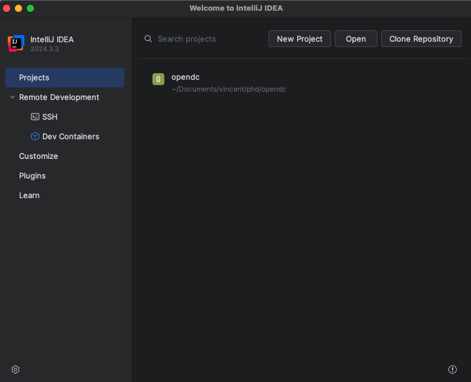
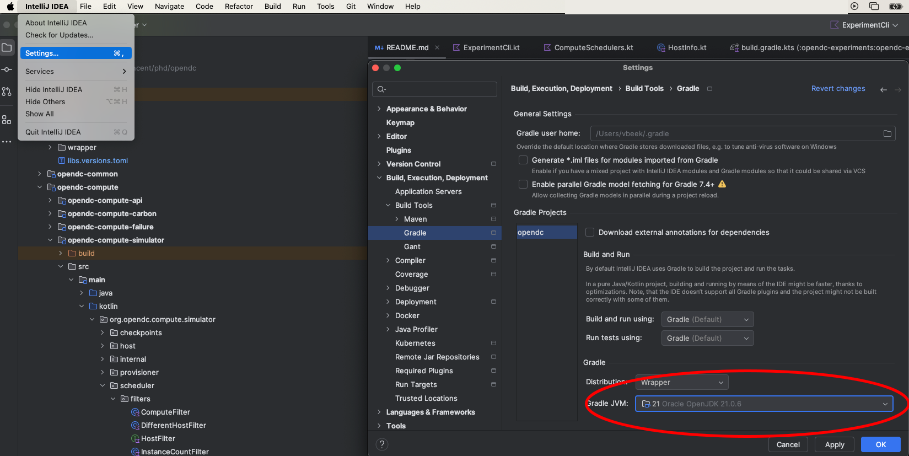
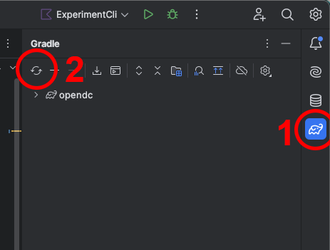

# Developing with IntelliJ

To change OpenDC, or to debug an experiment, you can run OpenDC from its source code in
[IntelliJ IDEA](https://www.jetbrains.com/idea/).

## Setting up the project

1. Clone the repository:

   ```bash
   git clone https://github.com/atlarge-research/opendc.git
   ```

2. Make sure Java 21 is installed. To list the installed versions:

   | System        | Command                                       |
   |---------------|-----------------------------------------------|
   | macOS         | `/usr/libexec/java_home -V`                   |
   | Debian/Ubuntu | `update-alternatives --list java`             |
   | Red Hat       | `yum list installed \| grep java`             |

3. Open the `opendc` folder in IntelliJ. It is imported as a Gradle project.

   

4. Set the Java version Gradle uses. In the settings, go to **Build, Execution, Deployment** → **Build Tools** →
   **Gradle**, and set **Gradle JVM** to Java 21. The version OpenDC needs is set by `java` in
   `gradle/libs.versions.toml`.

   

5. Open the Gradle panel on the right (1), and reload the project (2).

   

## Running an experiment from source

1. Open `opendc-cli/src/main/kotlin/org/opendc/cli/Main.kt`.
2. Click the run arrow next to `fun main`, and choose **Modify Run Configuration...**.
3. Set **Program arguments** to the command to run, such as `run experiment.json --no-progress`. See
   [Running OpenDC3](./1-running-opendc.md) for the commands and options.
4. Set **Working directory** to the folder with your experiment files.
5. Run the configuration, or start it in debug mode to use breakpoints.

`--no-progress` turns off the dashboard, which does not work well in the IntelliJ console.
